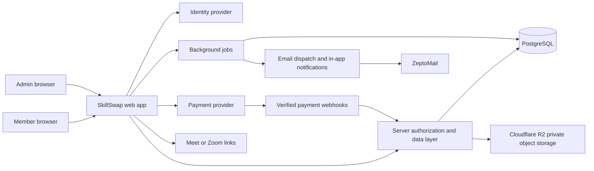

# SkillSwap — Phased Implementation Plan

**Status:** Working plan derived from the master PRD in [`SkillSwap.md`](./SkillSwap.md).  
**Product baseline:** one Member account type with both teaching and learning capabilities, plus a separate Admin account type.  
**Current build:** an authenticated Next.js App Router application in `skillswap-app/` with Member/Admin authorization, PostgreSQL-backed product workflows, and checked-in migrations. The dedicated local PostgreSQL instance is running; all 19 checked-in migrations are applied, and Prisma reports no schema differences. Credit posting remains disabled pending product-policy approval.

This plan turns the PRD into a build sequence with explicit decisions, dependencies, and exit criteria. The PRD remains the source of truth when prototype copy or implementation details conflict with it. Complete each phase’s exit criteria before moving to the next; defer later features until the MVP loop works end to end.

## Product invariants

1. **Two account types:** Member and Admin. A Member may teach in one exchange and learn in another using the same account. “Teacher” and “learner” are per-listing or per-session roles, not separate account types.
2. **Admin is operational access:** Admin accounts review safety, disputes, verification, and platform operations. Member-facing screens never grant admin privileges.
3. **The core loop is:** Discover → Match → Connect → Exchange → Review → Continue.
4. **Sessions are online and one-to-one in the initial release.** Sessions last 60 minutes; the 5-minute buffer is scheduling space and does not reduce session duration.
5. **Credits are closed-loop:** earn, buy, receive, hold, spend, and gift inside SkillSwap. Credits cannot be cashed out or transferred outside the product.
6. **Trust is explainable:** show a Trust Level and progress factors; do not expose private dispute history or create public rankings.
7. **Profiles and contact are controlled:** discovery, messaging, requests, private-profile access, hiding, and blocking must follow member settings.
8. **Prototype state is not production state:** demo data, local storage, and the Admin preview are replaced by authenticated, server-validated, persistent flows.

## Scope and current baseline

### MVP outcomes

- A new Member can register, create one profile, add skills to teach and skills to learn, and control profile visibility.
- A Member can discover people and skills, understand why a match was recommended, save a person or skill, and send a learning or direct-swap request.
- Two Members can connect, message, agree on a session time, complete a session, and leave optional feedback.
- Credit-based learning and direct swaps produce correct, auditable ledger entries for completion, cancellation, no-show, and dispute outcomes.
- An Admin can review reports and disputes, manage verification and account restrictions, and perform audited credit corrections.
- Members receive actionable notifications and can manage notification preferences.
- The MVP can be operated safely with support tools, backups, monitoring, and clear policies.

### Explicitly later unless validation changes priority

Native video rooms, group learning, premium membership, promoted profiles, professional tools, complex ML recommendations, and broad social-feed features are not needed to prove the core exchange loop. The PRD lists some community capabilities in the MVP; the plan starts with a deliberately small educational-post slice after core exchanges and safety are reliable.

### Prototype audit

The current static prototype covers overview, discovery, skill editing, sample exchanges, a sample credit wallet, saved teachers, and an Admin preview. Before replacing a screen, capture its useful layout and interaction intent. Preserve these product choices where they agree with the PRD:

- Both “I can teach” and “I want to learn” are visible on the same Member profile.
- Recommendations show a short reason.
- Admin is presented as a separate operator area.
- Responsive desktop and mobile layouts are part of the product, not a later polish task.

Replace sample balances, request confirmations, sessions, and admin queues with real server-backed state. Remove the Admin preview switch before production; it is not an authorization mechanism.

## Decisions to settle before production implementation

Resolve these before Phase 2. The working proposals, state diagrams, authorization matrix, and sign-off gates are in [`PHASE_1_DECISIONS.md`](./PHASE_1_DECISIONS.md). Do not let edge cases be decided ad hoc in payment or dispute code.

| Question                                   | PRD baseline                                                                                                 | Decision needed                                                                                                                                             |
| ------------------------------------------ | ------------------------------------------------------------------------------------------------------------ | ----------------------------------------------------------------------------------------------------------------------------------------------------------- |
| Direct-swap deposits for odd credit values | Each learner deposits half the value of the skill they want                                                  | Define rounding (`ceil` recommended for the deposit) and minimum deposit; show the amount before confirmation.                                              |
| Meaning of the 1-credit platform retention | One credit retained per completed credit-based session                                                       | Confirm who funds the retained credit when the listed price is only 1 credit, and whether the teacher’s displayed price is gross or net.                    |
| Direct-swap cancellation timing            | Late cancellation changes how deposits are allocated                                                         | Define “late” consistently (the session policy uses 24 hours), specify outcomes for every session order, and make mutual cancellation return both deposits. |
| Emergency compensation                     | Accepted emergency receives half the affected session value                                                  | Define rounding, funding source, review time, and how this interacts with a held deposit and completed first leg of a swap.                                 |
| No-show strike windows                     | Three teacher no-shows suspend teaching for three weeks; three learner no-shows restrict booking for a month | Define whether counts are lifetime or time-windowed, appeal path, and admin override/audit requirements.                                                    |
| Trust Level formula                        | Considers exchanges, ratings, verification, behavior, and activity                                           | Define inputs, minimum sample sizes, decay, review/appeal, and explainable member-facing reason text. Keep private dispute details private.                 |
| Private profile discovery                  | Basic details can appear; access can be requested                                                            | Finalize which fields are public, what access reveals, requester/owner notifications, expiration, and block interaction.                                    |
| Profile hide/restore                       | Existing activity continues; restore automatically after 3 months                                            | Define reminder, automatic restore consent, and which controls must be chosen again.                                                                        |
| Verification scope                         | General and skill verification are optional                                                                  | Define what evidence is collected, who can see it, retention/deletion, and whether identity documents are needed for MVP. Prefer collecting the minimum.    |
| Credit purchase and currency display       | Reference price `$2 = 6 credits`; purchases do not expire                                                    | Select payment provider and supported launch countries/currencies after fee, refund, tax, and legal review. Do not add cash-out.                            |
| Live meeting link                          | Zoom or Google Meet initially                                                                                | Decide whether Members supply their own link or SkillSwap creates one; specify visibility, link retention, and abuse reporting.                             |
| Reminder default                           | One default reminder, user-adjustable                                                                        | Pick default lead time and delivery channel; preserve local time-zone display.                                                                              |

## Recommended architecture decisions

These are recommendations for a first web MVP, not additional product commitments. Confirm them in Phase 1 before scaffolding production services.

| Area                   | Recommendation                                                                                                                                                        | Reason / constraint                                                                                                                                                                                                                                                                     |
| ---------------------- | --------------------------------------------------------------------------------------------------------------------------------------------------------------------- | --------------------------------------------------------------------------------------------------------------------------------------------------------------------------------------------------------------------------------------------------------------------------------------- |
| Application shape      | One TypeScript web application using the Next.js App Router                                                                                                           | Keeps member UI, admin UI, server rendering, and mutations in one deployable application. Keep business rules in service modules rather than page components.                                                                                                                           |
| UI                     | React with a tokenized CSS/design-system layer; adopt a component library only if it preserves accessibility and visual consistency                                   | The prototype is already HTML/CSS/JS. Migrate its useful patterns into components; avoid adding a heavy UI dependency before validating the system.                                                                                                                                     |
| Data store             | PostgreSQL                                                                                                                                                            | Profiles, skills, requests, sessions, disputes, and ledger events are relational and need constraints and atomic multi-row updates.                                                                                                                                                     |
| Data access            | Prisma ORM, with the version pinned during foundation work                                                                                                            | Fits typed relational access and migrations. Wrap multi-record credit/session operations in database transactions; add database constraints for invariants that can be expressed there.                                                                                                 |
| Authentication         | Managed identity provider (Clerk is the initial recommendation, matching the earlier project direction); keep the app’s Member/Admin role in the application database | Provider owns sign-in and identity proof. The application owns product authorization. Admin must be granted by an authorized operator, never by a client form or self-selected profile field.                                                                                           |
| Authorization          | Central server-side Data Access Layer (DAL) with `requireMember`, `requireAdmin`, and resource-ownership checks                                                       | Hiding buttons or guarding only a layout is insufficient. Every server mutation, handler, and sensitive read checks identity, role, and object-level access.                                                                                                                            |
| Server/client boundary | Server Components for server-owned reads; Server Actions for app mutations; Route Handlers for webhooks and integrations                                              | Treat every exported Server Action and Route Handler as a public endpoint: validate input, authorize, and return only necessary data.                                                                                                                                                   |
| Data validation        | Shared typed schemas at server boundaries; validate again on the server even when a form validates in the browser                                                     | All client inputs, IDs, state transitions, and prices are untrusted. Use explicit DTOs so private profile fields never leak into discovery responses.                                                                                                                                   |
| Chat                   | Persist messages in PostgreSQL first; use a managed realtime channel or polling only after message authorization and persistence are correct                          | Realtime delivery is an optimization. A message must remain durable, scoped to a conversation, and unavailable to blocked or disconnected users.                                                                                                                                        |
| Background work        | A small job/queue service for reminders, 3-month profile restoration, referral qualification, and retries                                                             | These events must run even when a user is offline and must be idempotent. Do not rely on an open browser tab or in-process timers.                                                                                                                                                      |
| Email delivery         | ZeptoMail for transactional email, called by the notification/job layer                                                                                               | Use for verification, account recovery, session reminders, and critical activity notices. Keep delivery credentials server-side; retry and deduplicate jobs and honor notification preferences.                                                                                         |
| Meeting integration    | Store a validated provider/link reference; start with user-supplied Meet/Zoom links unless a provider API is explicitly selected                                      | The PRD does not require video infrastructure. Avoid building a native room before the exchange loop is proven.                                                                                                                                                                         |
| File storage           | Cloudflare R2 private object storage with short-lived signed access for any approved evidence; no permanent public URLs                                               | Only add upload flows after the verification evidence/retention policy is defined. Never store uploads in an ephemeral application filesystem or expose evidence through public object URLs.                                                                                            |
| Credit records         | Append-only ledger entries plus explicit holds/reservations; derive the authoritative balance from ledger and holds                                                   | Do not mutate a balance without a corresponding reasoned ledger event. Use idempotency keys and transaction boundaries for settlement/refund.                                                                                                                                           |
| Payments               | Add a hosted payment-provider flow only after country, pricing, refund, and policy decisions                                                                          | The product’s non-cashable credit rules are a core invariant. Keep payment records separate from earned and promotional credit events.                                                                                                                                                  |
| Deployment             | Host the application on the designated local device; use managed PostgreSQL with backups and migrations                                                               | The local device is the application host, not the file store. Global access requires a stable internet connection, public HTTPS access, secure network configuration, monitoring, restart/recovery procedures, and a tested backup/restore process. Keep secrets out of the repository. |
| Analytics              | First-party event schema for activation, matching, requests, completed exchanges, repeat learning, safety, and credit operations                                      | Measure knowledge exchange and marketplace health, not only clicks. Avoid collecting message content or sensitive evidence as analytics.                                                                                                                                                |

### System boundary

### Domain model outline

Use normalized relational records with explicit state transitions. Names below are conceptual; validate final fields and indexes during schema design.

| Domain           | Core records                                                                                                       | Key rules                                                                                                                                 |
| ---------------- | ------------------------------------------------------------------------------------------------------------------ | ----------------------------------------------------------------------------------------------------------------------------------------- |
| Identity         | `User`, `MemberProfile`, `AdminGrant`, `UserPreference`                                                            | One product account per identity-provider subject. Default role is Member. Admin grants are server-created and audited.                   |
| Skills           | `Skill`, `SkillCategory`, `UserSkill`                                                                              | One Member owns both teach and learn listings. A listing stores direction, level, topics/outcomes, experience, and optional credit price. |
| Discovery        | `Follow`, `SavedItem`, `RecommendationFeedback`                                                                    | Saves/follows are separate from a connection; recommendation dismissals are recorded without exposing private reasons.                    |
| Privacy          | `VisibilitySetting`, `ProfileAccessRequest`, `Block`                                                               | Central visibility policy; block suppresses messaging and requests and removes follow/connection links per PRD.                           |
| Exchange         | `LearningRequest`, `ExchangeRequest`, `SwapLeg`, `Connection`                                                      | Requests have an explicit finite state machine, participants, direction, and cancellation reasons. Direct swap has two linked legs.       |
| Communication    | `Conversation`, `ConversationParticipant`, `Message`, `Report`                                                     | Conversation membership is checked on every read/write. Block and safety states can freeze communication.                                 |
| Sessions         | `Session`, `SessionParticipant`, `RescheduleProposal`, `SessionEvent`                                              | Store instants in UTC and the creator/participant IANA time zones. Accept/reschedule/cancel are explicit transitions.                     |
| Credits          | `CreditLedgerEntry`, `CreditHold`, `CreditPurchase`, `CreditGift`, `Promotion`                                     | Ledger is append-only. Holds are reservations, not earnings. Every credit movement has a source, recipient, reason, and idempotency key.  |
| Trust and safety | `Review`, `PrivateFeedback`, `Verification`, `TrustEvent`, `Dispute`, `Appeal`, `Strike`, `Suspension`, `AuditLog` | Private evidence and dispute history are access-restricted. Admin actions record actor, target, reason, and time.                         |
| Community        | `Post`, `Comment`, `Reaction`, `ContentReport`                                                                     | Learning-focused content; moderation, blocking, and visibility rules apply before broad feed ranking.                                     |
| Operations       | `Notification`, `NotificationPreference`, `Job`, `WebhookEvent`, `MetricEvent`                                     | Jobs and webhooks are deduplicated; delivery failures are retryable and observable.                                                       |

## Phased roadmap

Every phase includes a working demo or operational artifact. The exit checks include automated tests where they protect important behavior; test creation and execution happen during implementation, not in this planning document.

### Phase 0 — Design system and UX foundation

**Status:** In progress. Initial palette tokens, the recolored generated logo, component showcase, prototype journey audit, and screen map are recorded in [`DESIGN_SYSTEM.md`](./DESIGN_SYSTEM.md), [`design-system.html`](./design-system.html), and the `skillswap-*.png` assets. The rendered responsive/accessibility review remains open.

**Goal:** Replace one-off prototype styling with a coherent, accessible interface system before growing the screen count.

**Work**

- Audit the current static prototype and map its existing interactions to PRD journeys.
- Set foundations: color roles, typography, spacing scale, grid, breakpoints, radii, elevation, focus, success/warning/error states, and motion rules.
- Design responsive navigation for Member and Admin surfaces separately.
- Build primitives: buttons, links, inputs, select, checkbox, tabs, dialog, toast, badge, avatar, empty state, loading state, alert, card, table, and pagination.
- Build product components: skill chip/listing, profile summary, match card with reason, Trust Level display, credit amount, session summary, request state, report queue row.
- Define keyboard behavior, visible focus, reduced-motion behavior, contrast targets, and screen-reader labels.
- Create screen maps and low/high fidelity screens for sign-up, onboarding, profile, discovery, requests, messages, session details, wallet, privacy settings, and admin queues.

**Deliverables:** design tokens, component inventory, interaction states, screen map, responsive prototypes, and a visual reference page in the app.

**Exit criteria:** core pages remain usable at 360px and desktop widths; key components have default/hover/focus/disabled/error states; keyboard navigation and contrast are reviewed against WCAG 2.2 AA; no feature relies only on color to communicate state.

**Depends on:** PRD invariants and unresolved policy decisions that affect labels or flows.

### Phase 1 — Product and architecture decisions

**Status:** Product-policy baseline approved on 2026-10-10 as `phase1-approved-v1`, including the proposed credit/cancellation outcomes and data-retention rules. Payment-provider/launch-region decisions, auth confirmation, local-device public hosting feasibility, legal/privacy review, and Phase 0's responsive/accessibility review remain open.

**Goal:** Freeze the domain rules and system boundaries before schema or production APIs are written.

**Work**

- Resolve the table in “Decisions to settle” or record an explicit temporary MVP rule and owner for each item.
- Confirm the architecture recommendations above: application framework, auth provider, PostgreSQL/ORM, hosting, file storage, notification provider, payment provider evaluation, and realtime-chat threshold.
- Define role and resource authorization matrix for Member and Admin, including profile privacy, private conversations, requests, sessions, disputes, and admin APIs.
- Write state diagrams for learning requests, direct-swap requests, sessions, credit holds, disputes, verification, and suspensions.
- Write credit examples for successful session, late cancellation, mutual cancellation, no-show, emergency, swap with first leg complete, and dispute reversal.
- Define event and data-retention map for profile fields, message data, reports, verification artifacts, payment references, analytics, and audit logs.
- Define service-level expectations for session reminders, payment webhook processing, and admin review queues.

**Deliverables:** architecture decision records, authorization matrix, lifecycle diagrams, credit-rule examples, data classification/retention table, and accepted MVP scope.

**Exit criteria:** all credit and cancellation paths have a deterministic outcome; every sensitive object has an explicit owner/reader/writer policy; third-party providers and launch region assumptions are recorded.

### Phase 2 — Engineering foundation

**Status:** In progress. The non-production Next.js app shell, provider-neutral identity/Admin-grant schema, initial PostgreSQL migration, CI/security workflows, and local-device/R2 runbooks are in `skillswap-app/`, `.github/`, and `docs/operations/`. Dependencies are locked, Prisma generation succeeds, the development server starts locally, and PostgreSQL migration deployment has now been exercised through all 19 checked-in migrations with no schema drift. The local build uses Webpack and Next's project-local WASM compiler cache because the Windows native SWC binary is incompatible in this environment. GitHub CI and local-device public deployment/recovery remain unverified. Phase 1 sign-offs for launch region/payment evaluation and product accounting policies remain open; payment, upload configuration, and public-host deployment remain later-phase work.

**Goal:** Turn the prototype repository into a maintainable application foundation.

**Work**

- Create the app shell, route groups, component and domain folders, type checking, linting, formatting, and local environment instructions.
- Migrate prototype tokens and primitives into the chosen app framework without introducing prototype sample state as production data.
- Add development, preview, staging, and production environment separation on the local-device host; document secret names without committing secret values.
- Add CI for lint, typecheck, production build, and focused automated tests; configure dependency update and secret scanning.
- Add database connection, migration workflow, seed fixtures that are obviously synthetic, and safe reset instructions for local development.
- Add structured logging, request IDs, error reporting, health checks, and basic performance budgets.
- Create local-device deployment, restart, network recovery, and rollback playbooks; test PostgreSQL and R2 backup restoration before storing real Member data.

**Deliverables:** running app shell, CI pipeline, local-device development/staging environment, schema migration workflow, seed data, operations guide, and R2 bucket configuration guide.

**Exit criteria:** clean checkout can be installed and run from documented steps; CI is required for changes; the app can be deployed, restarted, and rolled back on the local device; external access uses HTTPS; no production secrets or real user data appear in fixtures.

### Phase 3 — Authentication, account types, and onboarding

**Status:** In progress. Better Auth-based email/password registration and sign-in, email verification/recovery screens, the ZeptoMail delivery adapter, Member onboarding persistence, server-side Member/Admin guards, and an audited operator bootstrap/recovery path are implemented in `skillswap-app/`. TypeScript and Prisma client generation pass. The Better Auth choice is provisional pending owner sign-off before public launch; live email delivery and an end-to-end access-boundary walkthrough remain outstanding.

**Goal:** Implement the Member/Admin account model and safe access boundaries.

**Work**

- Implement sign-up, sign-in, sign-out, email verification, and account recovery using the selected identity provider.
- On sign-up, create one app `User` row and `MemberProfile`; do not offer a teacher-vs-learner account choice or accept a client-controlled role.
- Create admin grants only through a controlled, audited operator process; keep at least one documented bootstrap-admin recovery path.
- Implement a centralized server DAL with `requireMember`, `requireAdmin`, ownership checks, minimal DTOs, and consistent 401/403 behavior.
- Protect every Admin page, Server Action, Route Handler, data query, and background operation; UI hiding is supplementary only.
- Build onboarding for name, location/time zone, about, teach skills, learn skills, availability, and discoverability preferences.
- Add account suspension and blocked-account behavior to the authorization path.

**Deliverables:** authenticated Member journey, controlled Admin provisioning, onboarding flow, authorization matrix in code, audit event for privileged grants.

**Exit criteria:** new users become Members; no client-controlled role field can grant Admin; direct requests to admin actions are denied for Members; account identity can be mapped reliably to one Member profile.

### Phase 4 — Profiles, skills, and privacy controls

**Goal:** Make the unified Member profile useful, discoverable, and privacy-aware.

**Work**

- Build editable profile and skill listings for both directions on the same account.
- Implement categories, skill topics, outcomes, experience level, years of experience, optional verification, and per-session credit pricing.
- Implement public/private visibility, searchable state, request/message preferences, direct-swap preferences, and temporary hide/restore.
- Add profile access requests with approve, decline, ignore, block, optional reason, notification, and revocation.
- Create field-level response DTOs for public profile, basic private preview, approved private view, and self view.
- Add profile completeness nudges and test that private credit balance never appears on public profile responses.

**Deliverables:** Member profile editor, teach/learn skill manager, privacy settings, profile access-request flow.

**Implementation status:** Complete for Phase 4 scope. The profile editor, teach/learn skill listings and categories, privacy preferences, three-month hide/restore, private-profile preview and access approval lifecycle, blocking, completeness nudges, and field-allowlisted self/public/private DTOs are implemented in `skillswap-app/`. Existing onboarding skill arrays are migrated and synced into listings. ZeptoMail access-request and decision notifications are wired through the existing email adapter. The dedicated local PostgreSQL database is configured and all migrations are applied. A database-backed privacy-state walkthrough passed for public details, private preview, pending and approved access, blocking, temporary hiding, and mandatory privacy review after restoration. Notification retries/deduplication remain part of Phase 13's notification/job layer.

**Exit criteria:** one Member can manage both teaching and learning skills; profile DTOs enforce visibility, access grants, blocks, and hide periods; restored profiles return to a basic preview until their owner reviews privacy settings. Phase 5 discovery queries must apply the same visibility and hide rules. Later exchange/session and conversation flows must preserve existing activity when discovery is hidden.

### Phase 5 — Skill discovery, search, and matching

**Goal:** Help Members find relevant people without making recommendations opaque.

**Work**

- Implement skill/person/category search, browse pages, category navigation, pagination, filters, and sorting.
- Implement first-pass deterministic recommendations from teach/learn overlap, level, availability, trust, verification, and stated preferences.
- Attach one concise “why this was shown” reason to every recommendation.
- Add direct-swap matching using two-way teach/learn overlap and show the two skills and proposed order.
- Add save/unsave for teachers and skills, skill follows, people follows, and dismiss recommendation with optional reason.
- Add personalization pause/off/reset controls; retain non-personal relevance and stated-interest matching when personalization is off.
- Add availability and inactivity filtering without exposing exact private active status.

**Deliverables:** searchable directory, match list, direct-swap candidates, saved area, followed skills/people, dismissal and personalization controls.

**Implementation status:** Complete for the current Phase 5 scope. `/discover` provides category and text search, teach/learn direction, level, verified-skill, shared-availability, coarse recent-activity filters, sorting, pagination, privacy-safe member cards, and concise match reasons. Members can save/follow or dismiss profiles and save/follow skills; recommendation settings support active, paused, off, minimum Trust Level, and reset. `/discover/swaps` shows two-way skill overlap and proposed session order, and `/saved` lists saved/followed people and skills. Discovery reads filter inactive, undiscoverable, hidden, unverified, admin, and mutually blocked accounts and use the Phase 4 profile visibility policy. TypeScript, ESLint, and PostgreSQL migration status pass. Trust remains at its schema default until a later trust progression phase; availability is currently a coarse profile-provided signal, not calendar overlap. Learning requests and swap acceptance are Phase 6 work.

**Exit criteria:** matching is explainable and filterable; users can browse without accepting recommendations; private/hidden/blocked accounts are filtered consistently; search ranking does not treat Trust Level as a public popularity score.

### Phase 6 — Learning requests, connections, messaging, and safety controls

**Goal:** Allow Members to agree on what they will exchange and communicate safely.

**Work**

- Build learning-request creation, edit, close, public/private response, and response with an optional teach-offer.
- Build request flow for credit-based learning and direct swaps; include parties, skills, scope, expected outcome, and state history.
- Define connection transitions and message eligibility from the PRD’s connection/privacy settings.
- Build durable conversation and message records with conversation membership checks, unread state, pagination, and abuse reporting.
- Implement block semantics atomically across messaging, connection lists, followers, and new requests.
- Implement report flow with category, context, optional evidence, receipt confirmation, and private case access.
- Add rate limits and anti-spam controls for requests, messages, follows, and report submissions.

**Deliverables:** learning request board, response/invitation flow, conversations, block/report controls, Admin report queue input.

**Implementation status:** Complete for the Phase 6 application scope. Members can post, edit, and close learning requests; send public or private responses with a matching teach offer; accept, decline, or withdraw responses; and send, accept, decline, or withdraw credit-learning and direct-swap requests. Accepted requests establish a connection and private conversation. Messaging checks participant membership, active connection, account status, consent settings, and mutual block state on every read/write; messages are persisted with pagination and unread counters. Blocking closes pending pairwise requests, deactivates conversations, removes mutual people/skill follows, and ends the connection in one transaction. Rate limits cover requests, responses, follows, messages, and reports. Members can submit private reports with context and linked message evidence; Admins get an audited triage queue. Typecheck, lint, migration status, and production build pass. File attachments remain disabled until the private R2 upload and evidence-retention policy are configured; context and conversation/message references work now. Session booking, credit holds, and settlement remain later phases.

**Exit criteria:** only authorized conversation participants can read/write; blocked users cannot initiate or continue prohibited interactions; reports preserve context for Admin review without exposing private case notes to other Members.

### Phase 7 — Scheduling and online sessions

**Goal:** Book reliable one-to-one learning sessions across time zones.

**Work**

- Implement manual time proposals, participant acceptance, time-zone display, and a 60-minute session plus 5-minute buffer.
- Store session instants in UTC and store IANA time zone IDs for display and future changes.
- Build reschedule proposals with proposer, reason, response deadline, acceptance, and both required notifications.
- Enforce the 24-hour reschedule/cancellation rule and connect late changes to the Phase 1 settlement table.
- Add one configurable reminder, join-ready session page, participant/profile context, and a validated external meeting link.
- Build cancellation reasons, emergency report submission, no-show reports, and event history visible to both participants as appropriate.
- Add session status transitions: proposed → confirmed → completed/cancelled/no-show/disputed.

**Deliverables:** session calendar/list, create/reschedule/cancel flows, reminders, session details, time-zone-safe display.

**Exit criteria:** only accepted proposals create confirmed sessions; double booking is prevented or clearly resolved; session history records every state change; DST transitions display correctly; a participant cannot mark another user’s attendance by changing client input.

**Implementation status:** Complete for the Phase 7 application scope. Members can create and accept initial time proposals and reschedules; UTC instants are paired with the proposer’s IANA time zone, and local-time conversion rejects daylight-saving gaps and overlaps. Confirmed sessions last 60 minutes plus a 5-minute buffer, and serializable acceptance checks with participant-row locks prevent overlapping confirmed sessions. Direct swaps can be scheduled as two separate, role-reversed session legs. Session pages show each participant’s current local time, encrypted participant-only Zoom/Google Meet links, configurable email reminders, completion marks from both participants, cancellation history, and private emergency/no-show reports. Admins can review incidents with audited decisions. Blocking a member closes pending or confirmed sessions and clears their unsent reminders. A local reminder worker sends through ZeptoMail when configured. Late changes are recorded for Phase 8 settlement review; credit holds, penalties, emergency compensation, and no-show strikes are not applied until the Phase 8 ledger and approved policy are implemented. No calendar-provider APIs or automatic time suggestions are included.

### Phase 8 — Credit wallet and credit-based learning

**Goal:** Make credit movement correct, recoverable, and auditable.

**Work**

- Implement immutable credit ledger and reservation/hold records. Derive spendable balance from posted entries minus active holds.
- Model credit sources separately: teaching earnings, purchased credits, promotional credits, referral credits, gifts, refunds, platform retention, and admin corrections.
- Hold the learner’s listed price when a session is confirmed; release/settle only on the Phase 1-defined completion outcome.
- Apply the one-credit session retention rule with a clear gross/net display and source attribution.
- Add idempotency keys, database transactions, concurrency control, and audit metadata to booking, settlement, refund, gift, and adjustment operations.
- Implement wallet history, filters, balance explanation, and notifications for each movement.
- Prevent negative spendable balances and prevent any withdrawal/cash-out path.

**Deliverables:** Member wallet, credit ledger, hold and settlement services, administrative reconciliation view.

**Exit criteria:** retrying the same booking or webhook cannot double-charge; concurrent bookings cannot spend the same available credits; every balance can be reconstructed from the ledger; cancelled or disputed sessions resolve through specified ledger events rather than deletion or silent edits.

**Implementation status:** Ledger tables and append-only balanced postings, idempotent hold/release/completion services, wallet history and balances, session price snapshots, and a read-only Admin reconciliation queue are implemented. Database triggers enforce zero-sum transactions with at least two postings and reject edits/deletions. The owner approved the applicable Phase 1 accounting/cancellation policy as `phase1-approved-v1`; settlement remains off by default. Added a local-only synthetic-credit fixture and manual scenario walkthrough; neither has been executed yet. Phase 8 still needs operational/legal review and scenario verification before launch.

### Phase 9 — Direct SkillSwap protocol

**Goal:** Implement the signature two-leg exchange without relying on informal trust alone.

**Work**

- Create a direct-swap request with both skill listings, order, expected duration, and each half-value deposit.
- Hold each deposit before confirmation; disclose the amount, rounding rule, and possible outcomes to both users.
- Support either order of sessions and define transition logic for first leg complete, second leg pending, mutual cancellation, late cancellation, no-show, emergency, and dispute.
- Release deposits only when both sides satisfy completion rules; apply strike/restriction policy from Admin-reviewed outcomes.
- Keep direct-swap restriction separate from general Member abilities as described in the PRD.
- Add an Admin resolution panel that displays evidence and calculated credit outcomes before finalization.

**Deliverables:** direct-swap state machine, two-leg session view, held-credit display, Admin dispute resolution controls.

**Exit criteria:** all transition paths have deterministic ledger outcomes; no deposit is released twice; a user restricted from direct swaps can still use credit-based learning and other permitted product features.

**Implementation status:** Direct-swap agreements now snapshot both skill values and each member's ceiling-half deposit quote. Both session legs must have proposed times before either is confirmed; when credit posting is enabled, both deposits are locked atomically before confirmation. Both participants must mark both legs complete before both deposits are returned. Mutual cancellation requires the other participant's explicit confirmation. Declined times, cancellation requests, and emergency/no-show reports move the exchange into an Admin review queue with both leg histories, deposit/value details, and outcome previews. Admin resolution posts balanced ledger entries for late cancellation/no-show before teaching, failure after teaching with reserve-funded full-value compensation, and accepted emergencies with half-value compensation. Upheld direct-swap no-shows add a separate strike; the third strike suspends direct-swap access for 30 days without restricting credit learning or other Member features. The owner approved the policy as `phase1-approved-v1`; settlement remains off by default. Added a local-only synthetic-credit fixture and scenario walkthrough, but the credit outcomes have not yet been exercised end to end.

### Phase 10 — Reviews, trust, verification, disputes, and appeals

**Goal:** Build accountable feedback and enforceable trust decisions without popularity mechanics.

**Work**

- Permit one optional review per side per completed session; separate public feedback, rating, and private feedback.
- Calculate and display public Trust Level, ratings, verified badges, completed exchanges, and progress to next level.
- Implement Trust Level events with reason codes, notification on actual level changes, review-before-negative-impact where required, and appeal submission.
- Build general and skill verification request queues; restrict evidence access and enforce retention/deletion policy.
- Store approved verification evidence in private Cloudflare R2 objects; issue short-lived signed access only after server-side authorization and audit access to sensitive evidence.
- Build dispute opening, relevant credit freeze, exchange pause between parties, evidence timeline, Admin decision, one appeal, and final ledger action.
- Keep dispute evidence and history private; disclose only approved, appropriate explanations to affected Members.
- Add strike thresholds, direct-swap suspension, teacher suspension, and booking restrictions as configurable policy records with audit trail.

**Deliverables:** post-session feedback, Trust Level view, verification queues, dispute and appeal workflows, trust/suspension history.

**Implementation status:** The app now supports one private/public review per completed session, public Trust Level and reputation details, audited level changes with ZeptoMail notifications, identity and skill verification review with private R2 evidence links and retention cleanup, and configurable trust/restriction policy. Credit-learning disputes can freeze active holds, pause the session, receive one appeal, and record a member-safe final outcome; Admin actions and evidence access are audited. Ratings do not automatically reduce Trust Level or trigger restrictions. The Phase 10 migration is applied and the schema is current. Live R2/ZeptoMail configuration and a dispute-specific evidence timeline/attachment exchange remain incomplete. Credit movement requires the approved Phase 1 policy version and explicit enablement; production evidence collection still requires legal/privacy review. See `skillswap-app/README.md` and `docs/operations/r2-storage.md` for operating boundaries.

**Exit criteria:** reviews cannot be duplicated or submitted before completion; one poor review alone does not trigger punishment; admins can explain a decision without revealing private dispute history; every trust restriction and appeal outcome is audited.

### Phase 11 — Admin operations and marketplace governance

**Goal:** Give authorized staff a safe, narrow, auditable way to run the service.

**Work**

- Build separate Admin navigation and pages for users, reports, disputes, appeals, verifications, categories, sessions, credits, and metrics.
- Use least-privilege Admin actions and require reason text for suspension, verification decisions, credit correction, and trust changes.
- Record actor, target, before/after state, reason, timestamp, and request ID in immutable audit events.
- Add queue priority, assignment, aging, filters, search, and conflict-of-interest cues.
- Implement emergency access and break-glass logging; define admin onboarding/offboarding and credential hardening.
- Add export restrictions and sensitive-field redaction in Admin tables.

**Deliverables:** usable Admin console, queue workflows, admin permission map, audit log viewer, operator runbook.

**Exit criteria:** Member credentials never access Admin endpoints; sensitive evidence is viewable only by authorized staff; every privileged mutation is attributable and reviewable; a departed admin can be revoked promptly.

**Implementation status:** Admin navigation now links to member/offboarding controls, operational queues, catalog categories, session review, aggregate metrics, the append-only audit log, and the existing trust/verification workspace. Safety reports, incidents, disputes, verifications, and direct swaps support priority and Admin assignment with server-checked conflict exclusions and reasoned audit events. Account suspension/restriction revokes active auth sessions; Admin offboarding revokes the grant and preserves at least one active Admin. Sensitive exports are not provided; emails are masked in the member list, audit details are redacted, and meeting/private case content is excluded from operational views unless the Admin workflow requires it. The Phase 11 schema migration is applied and the live schema matches Prisma. MFA enforcement remains an operator/identity-provider setup requirement before public launch. See the Admin section in `docs/operations/local-device-runbook.md`.

### Phase 12 — Credit purchase, gifts, welcome/referral rewards

**Goal:** Add permitted credit acquisition without compromising the ledger or cross-border experience.

**Work**

- Integrate the selected hosted payment flow after country, tax, refund, and pricing review.
- Verify signed webhooks server-side; process them idempotently; reconcile provider event IDs to ledger entries.
- Display user-selected local currency while keeping canonical credit quantity and charged currency/amount explicit at checkout.
- Implement welcome, profile-completion, first-exchange, and referral rewards with eligibility rules, expiry policy for promotional credits, and abuse controls.
- Implement credit gifts with recipient lookup, amount limits, optional message, confirmation, ledger entries, and notification.
- Handle payment failure, refund, chargeback, webhook retry, and duplicate event paths without mutating history.

**Deliverables:** hosted checkout, gift flow, promotional/referral rules, reconciliation and refund playbook.

**Implementation status:** Partially implemented. `/wallet/gift` supports Member lookup, optional messages, bounded gift amounts, a rolling daily cap, mutual block checks, idempotent balanced ledger postings, wallet history, and best-effort ZeptoMail notification. Public member profiles link to the gift form. The Phase 12 migration is applied, but all credit movement remains behind the existing credit-policy gate. No payment provider or commercial policy has been approved, so hosted checkout, signed provider webhooks, purchase/refund/chargeback reconciliation, welcome rewards, and referral promotions remain unimplemented. Do not select a provider, invent launch pricing, or enable credit posting in this phase. Phase 12 is not complete until those decisions and remaining flows are implemented.

**Exit criteria:** payment confirmation alone (verified server-side) creates purchased credits; user-supplied client callbacks cannot mint credits; purchases and promotional balances remain distinguishable for support while using one displayed currency.

### Phase 13 — Notifications, home feed, and learning community

**Goal:** Bring Members back to active learning and sharing without becoming a generic social network.

**Work**

- Implement in-app notification inbox and user preference controls by event and channel.
- Add ZeptoMail email delivery for critical events, retry/deduplication, unsubscribe rules where required, and timezone-aware reminders.
- Implement home feed from followed activity, skill opportunities, requests, sessions, and learning content with controls for type, skills, and followed activity volume.
- Add small educational post types: tip, project/demo, learning progress, and tutorial; support save, like, comment, follow, and report.
- Apply block, visibility, mute, and content moderation rules consistently in feeds, notifications, and search.

**Deliverables:** notification center/preferences, reminder jobs, customizable home feed, learning-focused content composer and view.

**Exit criteria:** duplicate jobs do not send duplicate critical notifications; users can turn off optional recommendations; hidden, blocked, or private content never appears through a feed cache or notification preview.

**Implementation status:** Partially implemented. A database-backed notification inbox supports idempotent enqueue, read state, per-category in-app/email preferences, and a ZeptoMail outbox worker with row locking, retries, and bounded attempts. Message and session updates are queued; session reminders retain their local-time formatting and now honor the email session preference. `/community` supports public/follower-only tips, projects, progress updates, and tutorials; follow/skill filters, activity volume, save, appreciation, comments, reports, and member mutes are backed by PostgreSQL. The Admin community moderation queue can hide reported posts or dismiss reports with audit records. Feed queries and actions enforce account status, public profile visibility, blocks, mutes, and follower visibility. The Phase 13 migration is applied. The email outbox is at-least-once around an ambiguous provider timeout; a worker crash after provider acceptance but before database acknowledgement can result in a duplicate email. Configure `npm run notifications:send` on the local host to drain the outbox. More exhaustive notification coverage, moderation workflows, and deployment scheduling remain launch work.

### Phase 14 — Analytics, quality, beta, and launch readiness

**Goal:** Prove that Members complete and repeat real exchanges, and that the service is supportable.

**Work**

- Instrument activation, skills added, search-to-request, match acceptance, confirmed sessions, completions, repeat exchanges, direct-swap completion, credit purchases, and safety outcomes.
- Establish dashboards for supply/demand by category, match rate, session completion, no-show/dispute rate, repeat learning, trust changes, and credit reconciliation.
- Complete responsive, accessibility, privacy, security, abuse, performance, backup/restore, and operational-readiness reviews.
- Validate the local host's uptime, power/network recovery, HTTPS configuration, remote administration controls, and restore procedure before inviting a global beta cohort.
- Run end-to-end scenarios for Member signup through completed exchange, direct swap with each exception, Admin report/dispute resolution, and payment/refund retries.
- Pilot with a small group, review support load and marketplace imbalance, and fix high-impact failure paths before broad launch.
- Define incident response, support escalation, data export/deletion, moderation response, release rollback, and status communication.

**Deliverables:** launch checklist, beta scorecard, operator/on-call playbook, dashboards, signed-off privacy/security review.

**Exit criteria:** core journeys meet agreed completion/reliability targets; ledger reconciliation is clean; backups restore; critical accessibility/security issues are closed; support can respond to a reported safety issue and a disputed credit outcome.

**Implementation status:** Partially implemented. `/admin/metrics` now presents aggregate activation, skill supply/demand by category, request acceptance, session completion/no-show/dispute rates, repeat participation, direct-swap settlement, safety outcomes, trust changes, and per-transaction ledger balance checks. Metrics come from existing product records; search impressions are not collected, so search-to-request conversion is explicitly unavailable. The dashboard avoids member identifiers and private content, and purchase counts are not reported as revenue. Added a closed-beta scorecard, launch-readiness checklist, and incident-response playbook under `docs/operations/`. The local PostgreSQL instance is running, its per-user sign-in task is registered, all 19 migrations are applied, Prisma reports no schema differences, and a pre-migration backup is stored outside the repository. The production build and TypeScript pass using the local Webpack/WASM fallback. The app now has a PWA manifest, install icons, install guidance, and an offline fallback that excludes private data; actual device installation still depends on a production HTTPS URL and device/browser validation. Production host uptime/recovery, TLS and remote administration, restore evidence, accessibility/security sign-off, payment/refund end-to-end scenarios, beta targets, staffing/contacts, and actual pilot results still require an operator/product owner. No public launch readiness is claimed.

### Phase 15 — Post-MVP expansion

Start only after the MVP exchange loop has repeat use and safe operations.

- Native SkillSwap Live Skill Room, group learning, and richer learning plans.
- Expanded skill verification and professional tools.
- Premium memberships, promoted discovery, and partnerships after trust and marketplace effects are evaluated.
- More advanced recommendation models after there is enough high-quality, consented behavioral data.
- Additional community formats and creator/organization features.

**Implementation status:** Partially implemented as a gated foundation. Members can create private learning plans with a skill, measurable goal, target date, up to 30 milestones, optional milestone targets, completion reflections, progress, and active/paused/completed states. Plan access is owner-scoped in every page and Server Action, and write actions are rate-limited. The Phase 15 migration is applied and the feature is available against the local database. The repeat-use and safe-operations entry gate is not evidenced: Phase 14 pilot, restore, accessibility/security sign-off, beta targets, and support staffing are still open. Defer Live Skill Rooms/group learning, paid memberships, promoted discovery, behavioral recommendations, and creator tools until their product, privacy, operating, and marketplace effects can be evaluated. No broad beta or production readiness is claimed.

## Cross-cutting quality gates

- **Accessibility:** WCAG 2.2 AA target, keyboard-first interaction, visible focus, labels and status announcements, zoom/reflow, and reduced motion.
- **Security:** server-side role and resource checks at every entry point; input validation; rate limits; CSRF/origin controls appropriate to the framework; secure secret handling; dependency and secret scans.
- **Privacy:** collect only needed data, explicit profile visibility rules, DTO allowlists, retention limits, safe logs, user export/deletion process, and no dispute or private-feedback leakage.
- **Ledger correctness:** immutable events, idempotency, concurrency safety, reconciliation, and scenario-based accounting review before real purchases.
- **Internationalization:** store instants in UTC, persist IANA time zones, render local times, avoid assuming a single currency or name format, and design for translated copy.
- **Operations:** structured logs, actionable alerts, backup restore, migration rollback strategy, incident playbooks, and admin audit trails.
- **Product quality:** every recommendation has a reason; every important action has a clear state; empty/loading/error states are designed, not accidental.

## Suggested release slices

1. **Design review:** responsive system and clickable Member/Admin flows, no live data.
2. **Private alpha:** authentication, Member profile, skills, privacy, search, basic request and admin provisioning.
3. **Exchange alpha:** connections, messaging, manual scheduling, online link, completion, reviews.
4. **Credit beta:** ledger, holds, credit-based learning, direct swaps, cancellation/no-show/dispute resolution.
5. **Closed beta:** notifications, safety queues, verification, minimal credit purchase/gift, analytics, support operations.
6. **Public launch:** only after privacy, payment, moderation, reliability, accessibility, and marketplace readiness gates pass.

## Official technical references

- [Next.js Authentication guide](https://nextjs.org/docs/app/guides/authentication) — recommends a centralized Data Access Layer and secure checks at server actions and route handlers.
- [Next.js Data Security guide](https://nextjs.org/docs/app/guides/data-security) — treats Server Actions as public endpoints, calls for server-side authorization and input validation, and recommends keeping private data out of client DTOs.
- [Clerk authorization checks for Next.js](https://clerk.com/docs/nextjs/guides/secure/authorization-checks) and [basic RBAC with metadata](https://clerk.com/docs/guides/secure/basic-rbac) — reference for provider-side identity and role claims; SkillSwap still keeps its product role and resource rules server-authoritative.
- [Prisma transactions](https://www.prisma.io/docs/orm/fundamentals/transactions) and [PostgreSQL transactions](https://www.postgresql.org/docs/18/tutorial-transactions.html) — reference for atomic multi-record operations such as credit holds and settlement.
- [PostgreSQL constraints](https://www.postgresql.org/docs/current/ddl-constraints.html) — reference for database-level uniqueness, foreign-key, and check constraints.
- [W3C WCAG 2.2](https://www.w3.org/TR/WCAG22/) — accessibility target for UI design and validation.
