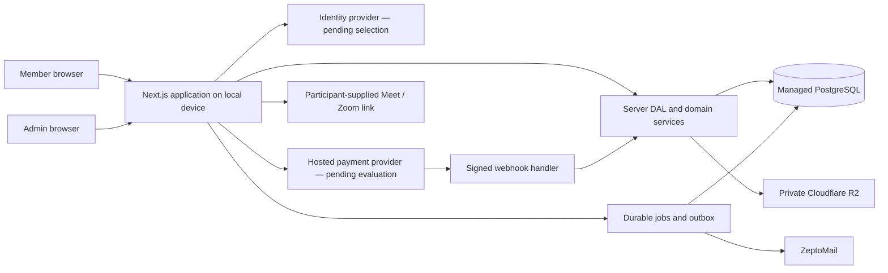
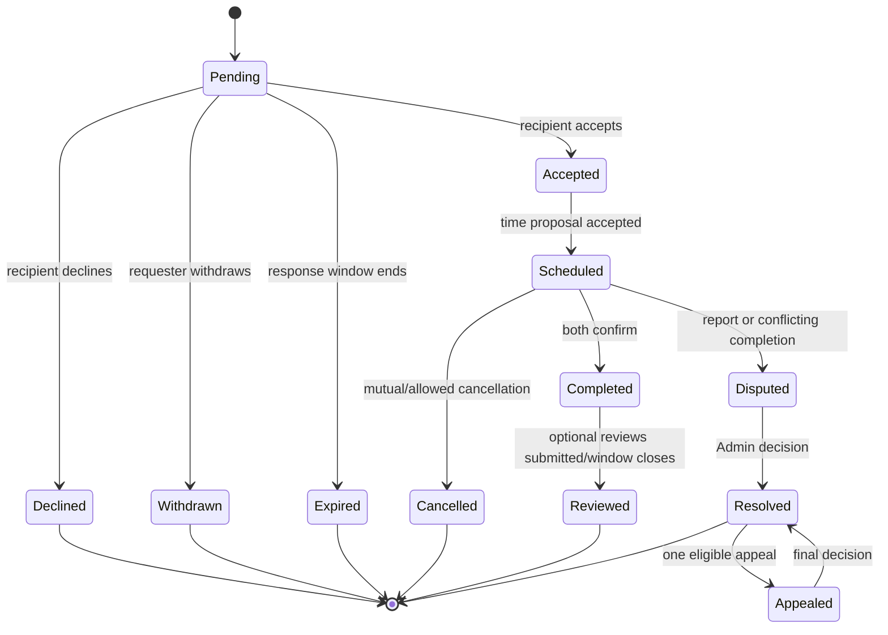

# SkillSwap Phase 1 — Product and architecture decisions

**Status:** The product owner approved the proposed Phase 1 product-policy baseline on 2026-10-10. This approval does not authorize payment processing or public collection of verification evidence; launch-country legal/privacy review and operational readiness remain required.

**Scope:** Resolve the rules and boundaries needed before Phase 2 scaffolds the application. This document does not implement application services.
**Product source:** [`SkillSwap.md`](./SkillSwap.md). If a proposal below conflicts with the PRD, the PRD wins until the product owner approves a change.

## 1. Decision register

| ID | Area | Baseline for implementation | Status / condition |
|---|---|---|---|
| P1-01 | Account types | One `Member` type can teach and learn; separate `Admin` accounts operate the platform. Teaching/learning are exchange roles, never account roles. | Accepted product invariant |
| P1-02 | Web architecture | TypeScript, Next.js App Router, React, PostgreSQL, Prisma; domain rules live in server-side services behind a centralized DAL. | Recommended baseline; pin versions in Phase 2 |
| P1-03 | Authentication | Application database owns Member/Admin grants. Better Auth is the Phase 3 implementation baseline, following the owner's prior interest; it supports local hosting with email/password, email verification, recovery, and database-backed sessions. Admin remains an audited application grant, not a client role. | **Provisional implementation choice; confirm before public launch and decide MFA policy** |
| P1-04 | Hosting | Run the application on the designated local device. Use managed PostgreSQL and Cloudflare R2; expose only through stable HTTPS with monitoring and tested recovery. | User-selected direction; device/network readiness is a Phase 2/launch gate |
| P1-05 | Files | Cloudflare R2 private objects; no public evidence URLs. Signed, short-lived reads after server authorization; record access to sensitive evidence. | User-selected provider; evidence collection itself remains policy-gated |
| P1-06 | Email | ZeptoMail for transactional delivery through an idempotent job/notification layer. | User-selected provider |
| P1-07 | Meetings | Support user-supplied Zoom or Google Meet links. No calendar or meeting-provider API in MVP. Encrypt/protect links at rest, reveal only to confirmed participants, and remove them after the session-retention window. | Recommended MVP boundary; **retention window needs sign-off** |
| P1-08 | Payments | Do not select a processor yet. Evaluate PayPal and Paystack for the chosen launch country, supported currencies, fees, refunds/chargebacks, hosted checkout, and webhook support. No cash-out. | **Needs launch-country and owner decision** |
| P1-09 | Realtime chat | Persist and authorize messages in PostgreSQL first. Start with polling; add managed realtime only when latency and volume justify it and authorization is preserved. | Recommended baseline |
| P1-10 | Time | Store instants in UTC and each user's IANA timezone; render local time. Store currency amounts with ISO currency codes; Skill Credits are a separate integer unit. | Accepted technical baseline |
| P1-11 | Sessions | One-to-one, online, 60 minutes; 5-minute scheduling buffer; both parties accept proposed/rescheduled times. | PRD baseline |
| P1-12 | Credits | Integer, closed-loop credits. No cash-out or off-platform transfer. Append-only ledger plus explicit holds; every mutation is transactional and idempotent. | Accepted product invariant |

### Architecture boundary

All browser input and provider callbacks are untrusted. Server actions, route handlers, webhooks, file reads, and Admin actions validate input and check role plus resource access on every request. Client-side navigation and hidden controls are not security boundaries.

## 2. Temporary product rules for deterministic implementation

These proposed MVP rules were approved by the product owner on 2026-10-10 as policy version `phase1-approved-v1`. Financially meaningful rules must be covered by examples and an Admin audit trail. The approval records product policy; it does not replace launch-country legal/privacy review or enable settlement by itself.

| Rule | Proposed MVP behavior | Reason / approval gate |
|---|---|---|
| Direct-swap deposit | Each participant deposits `ceil(skill price / 2)` integer credits, minimum 1. Show each deposit and both sessions before confirmation. | Approved policy; implements “at least half” for odd values. |
| Minimum credit-based session price / retention | Minimum listed price is 2 credits. On successful completion, learner's held gross price settles as 1 platform-retained credit and `gross - 1` teacher earnings. Display gross price and teacher net before confirmation. | Approved policy; avoids a zero-credit teacher payout at a 1-credit price. |
| Session completion | Each participant may mark complete. Settlement occurs only when both mark complete, or after an Admin resolves a dispute. Do not infer completion from elapsed time. | Preserves the PRD's two-sided completion signal and prevents unilateral settlement. |
| Early cancellation | More than 24 hours before start: release the full hold; no credit penalty. | PRD says this is free. |
| Late cancellation | Less than 24 hours before start: apply the same credit outcome as the relevant no-show rule unless both mutually cancel. Learner cancellation forfeits 1 held credit to the teacher and releases the remainder; teacher cancellation releases the learner's full hold and grants 1 platform-funded bonus credit. | Approved policy; PRD defines late timing but not ordinary late-cancel accounting. |
| Mutual cancellation | When both participants affirm cancellation, release all holds, including inside 24 hours. Record both confirmations. | Proposed interpretation; do not let one party claim mutual cancellation alone. |
| No-show | Admin-confirmed learner no-show: deduct 1 credit, release remaining hold. Admin-confirmed teacher no-show: release learner's full hold and grant 1 bonus credit from the platform reserve. Require a dispute/report window before finalizing. | Matches stated PRD outcomes while making the funding source explicit. Admin-confirmation workflow is proposed. |
| No-show strike window | Count upheld no-show findings in a rolling 12-month window; an appeal pauses new restrictions until review. At threshold three, apply the PRD restriction and notify the Member. | Approved policy; PRD gives thresholds and durations, not a counting window. |
| Accepted emergency | Waive ordinary late-cancel/no-show penalties. Pay the affected participant `ceil(affected session value / 2)` from an explicitly funded platform reserve; release all unrelated holds. Admin records reason and evidence disposition. | Makes the PRD's half-value remedy deterministic without taking credits from the other participant. Funding policy must be approved. |
| Direct-swap success | Once both legs complete, return both deposits. No platform fee is applied to deposit principal. | PRD baseline. |
| Direct-swap mutual cancel | Return both deposits, regardless of session order, only after both parties confirm. | PRD baseline. |
| Direct-swap unilateral late cancel before counterpart teaches | Transfer the cancelling participant's held deposit to the other participant; release the other deposit. | PRD baseline; “late” uses the shared 24-hour boundary. |
| Direct-swap cancel/failure after counterpart teaches | Forfeit the responsible party's held deposit to the platform; compensate the participant who taught the completed leg with the full listed value of the skill they taught. Fund any shortfall from an explicit swap reserve, never from the other participant's deposit. Return any unaffected deposit. | PRD outcome; reserve avoids relying on deposit size being sufficient. Confirm funding/accounting before production. |
| Dispute | Freeze only related holds and affected settlement; preserve evidence and state history. Admin decision creates compensating ledger entries, never edits/deletes old entries. One appeal with new evidence; second decision is final for the in-product process. | Aligns with PRD and auditability. |
| Verification | General/skill verification is optional. Collect the minimum evidence needed for a decision; do not require identity documents for MVP. Evidence is Admin-only in private R2. Delete raw evidence 90 days after decision unless an active dispute/legal hold applies; retain decision metadata and access audit. | Retention baseline approved; complete legal/privacy review before production uploads ship. |
| Private profile | Discovery DTO exposes only approved basic fields: display name, optional avatar, skill listing titles/summary, and public trust indicators. Never expose email, exact location, private feedback, reports, or evidence. An access grant reveals only explicitly listed additional profile fields, not contact details. | Concrete allowlist needed for API design; approve before production. |
| Hide and restore | Hiding removes profile from discovery immediately but does not cancel existing sessions or conversations. At hide time, explain that the profile will restore after 3 months; send a reminder 7 days before. Restore the same chosen visibility unless the user opts to extend or restore earlier. | Approved policy; preserves PRD behavior and makes automatic restoration user-visible. |
| Trust Level | Start at Level 1. Never publish a leaderboard or overall popularity score. Positive progression requires minimum completed-exchange evidence and is explainable; negative change requires reviewed, upheld behavior evidence, notice, and appeal. Do not finalize numeric thresholds in Phase 1. | PRD lists factors but does not define a formula; opaque auto-scoring is not safe to invent. Thresholds remain a Phase 1 approval item. |
| Default reminder | Send one email reminder 24 hours before the session; allow the Member to change the lead time or disable email where appropriate. Render in their local timezone. | Explicit default proposal; notification preferences and provider failures must be handled. |

### Credit examples and invariants

1. **Successful 8-credit lesson:** hold 8 on confirmation; after both completions, post 1 credit to platform retention and 7 to teacher earnings. Learner's spendable balance falls by 8 exactly once.
2. **Early learner cancellation:** release the complete 8-credit hold; no ledger debit.
3. **Late learner cancellation/no-show:** post 1 credit to teacher compensation and release 7 to learner. A finalized event can be reversed only through a reasoned, linked compensating entry.
4. **Teacher late cancellation/no-show:** release all 8 to learner and issue 1 bonus credit from the platform reserve; do not charge the learner for the teacher's failure.
5. **Accepted emergency on an 8-credit lesson:** release the learner's unrelated hold and issue 4 credits to the affected participant from the emergency reserve; waive ordinary penalty.
6. **Direct swap prices 7 and 4:** hold deposits of 4 and 2 respectively. If both legs complete or both mutually cancel, return 4 and 2. If one leg was taught and the other side defaults, apply the responsible-deposit forfeiture and full taught-value compensation rule; use the swap reserve for any shortfall.
7. **Dispute reversal:** retain original settlement entries, add linked reversal/adjustment entries with actor, reason, case ID, and idempotency key; resulting available balance cannot become negative without an explicit debt/recovery policy.

**Ledger invariant:** a hold reduces spendable balance but is not an expense; every posted transaction balances by source/destination; retries cannot create a second hold, release, award, or webhook credit; no user can spend held credits.

## 3. Authorization matrix

`Own` means a Member may access their own resource. `Participant` means an authenticated participant may access only the fields needed for the active relationship. `Admin` means an explicitly provisioned Admin with a reasoned, audited action. Every row also requires server-side policy checks for hidden/private/blocked relationships.

| Resource / action | Anonymous | Member owner | Other Member / participant | Admin |
|---|---|---|---|---|
| Public profile fields | Read allowlisted public fields | Read/write own fields | Read allowlist; private extras only with active grant | Read only when needed for a case; access logged |
| Private profile fields | None | Read/write own fields | Read only explicit granted fields | Case-scoped access; reason and audit required |
| Skills and availability | Read searchable public listings | Create/update/archive own listings | Read public listing; request only if discoverable and not blocked | Moderate/remove with reason and audit |
| Profile access request | None | Approve/revoke incoming grants | Request access when allowed; cannot self-grant | Review abuse report; no routine impersonation |
| Saved items/follows/preferences | None | Own records only | No access | No routine access |
| Learning/swap requests | None | Read/respond to own requests; request under policy | Only as named counterparty | Read for support/dispute case; audited |
| Conversations/messages | None | Read/write conversations they participate in and are still permitted to access | Same participant-only rule; block/disconnect restrictions apply | Only with case authorization and audit; no broad browsing |
| Session, meeting link, attendance | None | Read/write own side of session | Named participant only; link visible only to confirmed participants | Case-scoped read; decisions and changes audited |
| Credit ledger and holds | None | Read own ledger; initiate allowed actions | No access | Read case/accounting records; adjustments require reason and second-person review for material correction |
| Verification evidence | None | Submit/view own request status; withdraw while policy permits | None | Assigned authorized reviewer only; every file read logged |
| Reports, disputes, appeals | None | Create and read own case-visible status/submissions | Only own participation and approved outcome notice | Assigned case access; sensitive notes remain Admin-only |
| Trust/strike/suspension | None | Read own current status and reasons/appeal path | Public approved trust indicators only | Review and modify by permission; immutable audit record |
| Admin/audit records | None | None | None | Least-privilege, scoped access; audit events are append-only |

### Cross-cutting enforcement

- Provision Admin grants out of band; no signup or profile field can create an Admin.
- Default deny. Check account status, role, resource ownership/participation, block state, visibility grant, and action state in the DAL/service for every read or write.
- Use explicit response DTOs so internal notes, contact data, private feedback, evidence keys, payment references, and audit metadata cannot leak through serialization.
- Admin access to private content is case-scoped, reason-coded, logged, and reviewed. Emergency access is separately logged.
- Block suppresses new requests/messages and removes discovery/follow surfaces per the PRD; it does not erase evidence needed to resolve an existing safety case.

## 4. Lifecycle state machines

### Learning request

### Direct swap

`Draft → Awaiting both deposits → Awaiting both confirmations → Scheduled leg 1 → Leg 1 complete → Scheduled leg 2 → Both complete → Settled`. From any pre-settlement state, cancellation, no-show, or dispute routes to `Resolution pending`; Admin outcome then creates one atomic ledger settlement and closes the case. Both linked sessions share one swap ID and cannot settle independently.

### Session and reschedule

`Proposed time → Accepted → Confirmed → (Reschedule proposed → accepted → Confirmed) → In progress → Awaiting both completion marks → Completed/settled`. A rejected/expired time proposal returns to the last valid scheduling state. Cancellation/no-show/emergency/dispute goes to `Resolution pending` before financial finalization. Reject overlapping confirmed sessions for either participant; compare UTC instants and retain the IANA zone used for display.

### Credit hold

`Available → Held (idempotency key + resource ID) → Released` or `Held → Settled (ledger postings)`. Dispute: `Held/settlement pending → Frozen → Admin resolution → Released/Settled/Compensated`. Never delete or mutate posted ledger rows. Retries return the outcome already associated with the same idempotency key.

### Dispute, verification, restriction

- Dispute: `Open → Triage → Evidence requested/collected → Decided → (Appeal submitted with new evidence → Final decision) → Closed`.
- Verification: `Not requested → Submitted → In review → Approved/Rejected/More information → Closed`; withdrawal/deletion is available only when no active case or retention hold prevents it.
- Restriction: `Active → Proposed (reason and evidence) → Notified/Appeal window → Active restriction → Expired or Admin lifted`; urgent temporary safety action can take effect immediately but must be reviewed and logged promptly.

## 5. Data classification and retention proposal

These retention values are the approved product baseline, not a substitute for launch-country legal review. Apply deletion jobs, legal holds, least-privilege access, and backups with defined expiry. Backups must age out deleted personal data on a documented cycle.

| Data class | Examples | Access | Proposed retention / handling |
|---|---|---|---|
| Public/member profile | Display name, bio, avatar, skill listings, public trust indicators | Owner; public allowlist or granted Member view | While account active; delete/anonymize on verified account-deletion request subject to legal/safety hold |
| Private profile/contact | Email, phone if collected, access grants, exact availability | Owner; narrow grant; case-scoped Admin | Never in public DTOs; remove on account deletion subject to statutory/accounting hold |
| Authentication/security | Provider subject, session/security events, recovery state | Auth service; limited security operators | Keep only as long as needed for account/security; retention schedule set with selected provider |
| Messages | Conversation messages and attachments if enabled | Participants; case-scoped Admin | Account lifetime plus 12 months after closure, then delete/anonymize; legal review remains required |
| Sessions and meeting links | Time, participants, status, link reference | Participants; case-scoped Admin | Keep session/audit metadata for 24 months; delete meeting link 30 days after session/cancellation |
| Credits/payments | Immutable ledger, provider event IDs, amounts/currency, refund reference | Owner sees own ledger; finance Admin | Retain financial records per applicable law; do not store card credentials; minimize provider payloads |
| Reports/disputes/appeals | Case notes, relevant messages/evidence, decisions | Case participants see approved status; assigned Admin | 24 months after case close; legal hold overrides scheduled deletion; case notes not public; legal review remains required |
| Verification evidence | Submitted files and decision result | Submitter status; assigned Admin reads raw file | Delete raw file 90 days after decision unless active appeal/legal hold; retain minimal decision metadata |
| Notifications/jobs | Delivery state, dedupe key, event type | Recipient sees own inbox; operators see delivery metadata | Inbox 12 months; delivery payload minimized and deleted after 30 days; retry records bounded |
| Analytics | Pseudonymous product events, aggregate counts | Approved product/analytics roles | No message/evidence content; pseudonymize and aggregate; raw event 13 months; legal review remains required |
| Admin audit | Actor, target, action, reason, request ID, before/after reference | Authorized auditors/Admins | Append-only; 7 years subject to legal review; exclude secrets and unnecessary content |

## 6. Operational expectations

These are internal targets for MVP planning, not public guarantees. Measure from durable event creation to completion and alert on sustained misses.

| Operation | Expected behavior |
|---|---|
| Session/reminder jobs | Default reminder 24 hours before start; process timezone-safe UTC schedule; queue/retry transient failures; deduplicate by user, session, reminder type, and schedule version. Show in-app state even if email fails. |
| ZeptoMail transactional email | Queue durable outbox event; attempt dispatch within 5 minutes for routine mail and immediately for security-critical mail; retry with bounded exponential backoff; record provider message ID and final delivery/bounce status without logging secrets. |
| Payment webhook (when chosen) | Verify signature and event age before accepting; persist provider event ID uniquely; acknowledge only after durable receipt; process asynchronously and idempotently; reconcile daily. Never mint credits from browser redirect alone. |
| Admin safety queue | Urgent credible imminent-harm reports receive immediate triage during staffed hours; ordinary reports targeted within 1 business day; dispute/verification queue targets 3/5 business days. Publish support availability before relying on these targets. |
| Background jobs | Durable queue/outbox, dead-letter visibility, replay tooling with idempotency, and alerting for repeated failures. No essential reminder or restore relies on an open browser. |
| Local-device availability | HTTPS, stable public ingress, restricted management access, automatic restart, health check, monitoring, UPS/network recovery plan, managed DB backups, and tested restore/rollback are prerequisites before public beta. |

## 7. Phase 1 sign-off checklist

- [x] Record the Member/Admin boundary and authorization rules.
- [x] Capture lifecycle states, resource ownership, and ledger invariants.
- [x] Record the previously selected R2, ZeptoMail, local-device hosting direction, and user-supplied Meet/Zoom approach.
- [x] Make missing credit/cancellation behavior explicit as proposed rules rather than silently leaving it to code.
- [x] Product owner approved the proposed MVP credit/cancellation, deposit, minimum-price/retention, emergency, strike-window, hide/restore, and data-retention baseline on 2026-10-10 (`phase1-approved-v1`). Numeric Trust Level thresholds remain intentionally unspecified; any legal/privacy review required for launch remains open.
- [ ] Select auth provider and launch country/region; evaluate PayPal/Paystack support, fees, refunds, and legal requirements for that launch.
- [ ] Confirm local-device public HTTPS/network/uptime capability and operational ownership.

**Phase 2 gate:** the product-policy approval is recorded. Credit settlement remains disabled by default and requires explicit local/deployment configuration for a controlled beta. Do not process real payments or collect production verification evidence, apply irreversible trust penalties, or expose the service publicly until the remaining provider, launch-country, legal/privacy, and operational gates are resolved. Phase 2 can scaffold non-production structure after the auth choice and hosting feasibility are confirmed.
